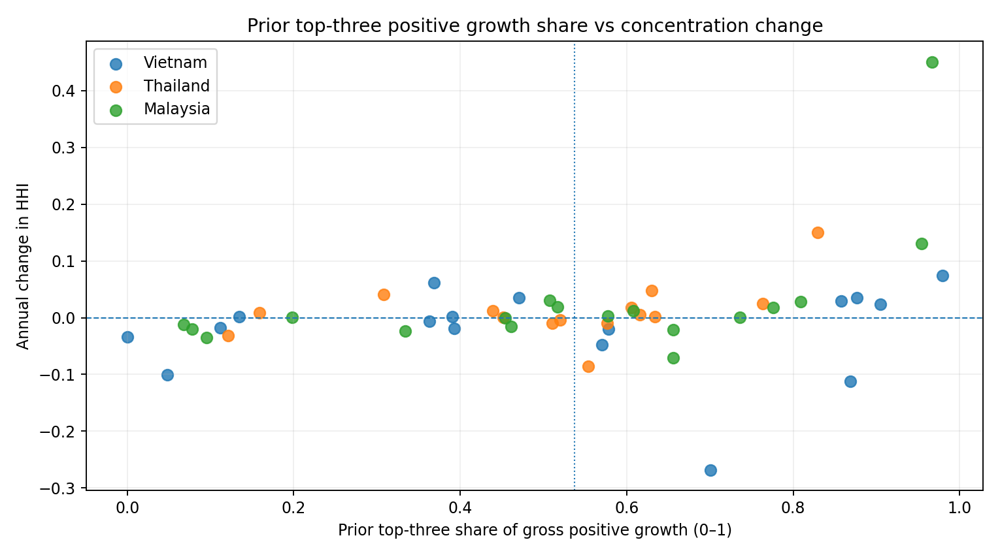

# Integrated Circuit Import Growth & Source Concentration (2019–2024)

**A reproducible Python research project measuring where HS6-level import growth came from and how trading-partner shares related to changing import-source concentration in Vietnam, Thailand, and Malaysia.**

`Python` · `CEPII BACI` · `Trade Data` · `HS6` · `Growth Attribution` · `HHI` · `Exploratory Analysis`

> **Status:** Working implementation of the revised CAS1100 course proposal (Plan B). Includes the two filtered input datasets, calculation pipeline, automated tests, generated result tables, charts, and a reproducibility guide. It studies **historical recorded trade sources**, not companies, production locations, causal explanations, or predicted supply-chain risks.

## Research questions

1. **Aggregate HS 8542:** How did major import trading partners, their shares, and concentration change across the three markets between 2019 and 2024?
2. **HS6 growth attribution:** Which trading partners contributed to import growth by product category, and how were their value/share changes associated with HHI changes?

**Exploratory hypothesis:** In market–HS6–year transitions with increasing total import value, cases with a larger share of gross positive growth coming from the **previous year's three largest trading partners** may show HHI increases more frequently. This is tested descriptively; the relationship is neither inevitable nor claimed causal.

## Results from the submitted filtered data

| Check | Observed result |
|---|---:|
| Input HS6 trade records | 4,798 |
| Reconciled HS8542 market-year-partner records | 1,520 |
| Market × HS6 × year groups | 90 |
| Annual market–HS6 comparisons | 75 |
| Comparisons with growing total nominal import value | 50 |
| HHI increases / decreases among those 50 | 28 / 22 |
| Median prior-top-3 positive-growth share | 0.5371 |
| HHI-increase rate: high / low top-3 contribution (median split) | 68% / 44% |

The exploratory split is an **in-sample descriptive result**, not a statistical claim of causation or a calibrated risk score. Product groups and adjacent years are not independent observations. The results also change when the treatment of source category **`Other Asia, nes` (490)** is changed.



More results and exact calculations: [`results/KEY_FINDINGS.md`](results/KEY_FINDINGS.md), the CSV files in [`results/`](results/), and [`docs/METHODOLOGY.md`](docs/METHODOLOGY.md).

## Run locally

Requires **Python 3.10+**. The entire numeric analysis uses the Python standard library; `matplotlib` creates optional PNG charts.

```bash
python -m pip install -r requirements.txt
python -m unittest discover -s tests -v
python src/analysis.py
```

On Windows, you can replace `python` with `py`. To run only the analysis without charts or installing any external packages:

```bash
python src/analysis.py --no-plots
```

The program checks the input schema, HS codes, year/market scope, duplicate keys, `v × 1,000 == trade_value_usd`, and exactly reconciles the two submitted input CSVs. It fails with an explanatory error rather than silently using inconsistent source data.

**Expected successful console checks:**

```text
PASS: 4798 HS6 input rows; 90 yearly HS6 groups; 1520 aggregate partners
PASS: 75 year transitions; 50 net-growth cases; 28 HHI rises; 22 HHI falls
Top-3 contribution global median: 0.5371
High vs low group HHI-rise frequency: 68.0% vs 44.0%
```

For Windows users, see [`docs/START_HERE_CN.md`](docs/START_HERE_CN.md).

### What the script creates

| Output | Purpose |
|---|---|
| [`aggregate_market_year.csv`](results/aggregate_market_year.csv) | Overall HS8542 totals, leading source and HHI across 18 market-years |
| [`aggregate_partner_shares.csv`](results/aggregate_partner_shares.csv) | Every recorded source's amount and share at overall HS8542 level |
| [`market_hs6_year.csv`](results/market_hs6_year.csv) | 90 market–product–year totals and product-level HHI |
| [`annual_growth_comparisons.csv`](results/annual_growth_comparisons.csv) | 75 year-on-year comparisons; net/gross positive/negative growth, HHI and Top 3 share |
| [`partner_growth_contributions.csv`](results/partner_growth_contributions.csv) | Per-source changes in absolute amount, market share, gross positive-growth contribution and HHI contribution |
| [`hypothesis_growth_cases.csv`](results/hypothesis_growth_cases.csv) | All net-growth cases used for descriptive median-split hypothesis check |
| [`hypothesis_group_summary.csv`](results/hypothesis_group_summary.csv) | High/low Top 3 comparison; HHI-rise rates and mean/median Top 3 share by HHI direction |
| [`hypothesis_group_summary_excluding_490.csv`](results/hypothesis_group_summary_excluding_490.csv) | Recomputed hypothesis comparison under the 490-exclusion scenario |
| [`sensitivity_490_yearly.csv`](results/sensitivity_490_yearly.csv) | Yearly full-versus-excluded HHI, source 490 share |
| [`sensitivity_490_comparisons.csv`](results/sensitivity_490_comparisons.csv) | Annual changes and whether excluding 490 reverses observed HHI direction |
| [`KEY_FINDINGS.md`](results/KEY_FINDINGS.md) | Automatically generated short fact summary, with caveats |
| [`figures/`](figures/) | Seven PNG charts: aggregate HHI, three product trend charts, hypothesis scatter/bar plots, and code-490 sensitivity |

All output files are generated by `python src/analysis.py`. Results shown here were produced using the checked-in filtered data, **not manually typed into reports**.

## Method in brief

The unit is **importing market `m` × HS6 product `k` × year `t` × recorded exporter `p`**. For each market/product/year:

```text
V[m,k,t,p]    = recorded nominal imports from partner p (USD)
T[m,k,t]      = sum of V[m,k,t,p] across partners
share[p,t]    = V[p,t] / T[t]
HHI[t]        = sum(share[p,t] ** 2)
delta_HHI     = HHI[t] - HHI[t-1]
delta_V[p]    = V[p,t] - V[p,t-1]
G             = sum(max(delta_V[p],0)) across all partners
growth_share[p] = max(delta_V[p],0) / G   # only if G > 0
partner_HHI_contribution[p] = share[p,t]**2 - share[p,t-1]**2
```

**Prior Top 3:** Rank partners by import value in **year `t-1`**, not year `t`; sum their `growth_share[p]`. Negative partner deltas are kept separately and **never netted into gross positive growth `G`**. Partners missing from one year are assigned value zero **only in comparisons**. The HHI attribution contributions sum to the overall `delta_HHI` by construction and are verified.

**Hypothesis check:** Restrict to transitions with `T[t] > T[t-1]`. Split the observed prior-Top-3 positive-growth ratios into high/low groups at their **observed sample median**. Report the HHI increase proportion in both groups and, in the reverse direction, compare mean and median Top 3 ratios among HHI-increase versus HHI-decrease cases. Repeat by country and HS6 where available. No significance or causal inference is claimed.

**Sensitivity:** Preserve code 490 in the official baseline. Repeat the calculation after removing code 490 from each year **before recalculating totals, market shares, Top 3 rankings, growth contribution, and HHI**. The sensitivity scenario does **not** correct an error in official BACI data.

See the detailed algorithm and interpretation guide in [`docs/METHODOLOGY.md`](docs/METHODOLOGY.md).

## Input data and scope

- **Source:** [CEPII BACI international trade dataset](https://www.cepii.fr/CEPII/en/bdd_modele/bdd_modele_item.asp?id=37), HS17 V202601.
- **Importers:** Vietnam (704), Thailand (764), Malaysia (458).
- **Years:** 2019–2024.
- **HS6:** `854231`, `854232`, `854233`, `854239`, `854290`. Includes integrated circuits **and parts**; not all semiconductor products.
- **Input:** [`data/semiconductor_hs6_detail.csv`](data/semiconductor_hs6_detail.csv) and [`data/semiconductor_trade_2019_2024.csv`](data/semiconductor_trade_2019_2024.csv).
- BACI field `v` is in **thousands of USD**, converted exactly to USD. Missing `q` values (708 rows) are retained because this study analyzes nominal amounts, not quantities.
- The **758 MB** upstream BACI archive is **not** required to run the project; the filtered CSVs are included. The script intentionally validates the fixed study scope and is not yet a generic any-country-any-year import app.

### Interpret responsibly

Import growth here means **nominal recorded trade value growth**, not verified physical demand growth. The data do not identify specific buying companies, chip part numbers, actual fabrication locations, firm inventory, logistics, or supply risks. Partner economies and statistical categories are not all individual countries. Do not equate increasing HHI with a measured probability of supply-chain failure.

## Repository structure

```text
semiconductor-import-growth-analysis/
├── README.md
├── data/                  # The two submitted, checked input CSVs
├── src/analysis.py         # End-to-end analysis engine and CLI
├── tests/test_analysis.py  # Unit and integration verification
├── results/                # Reproducible CSVs and generated findings
├── figures/                # Reproducible figures
├── docs/
│   ├── METHODOLOGY.md
│   ├── PROPOSAL_TO_CODE_MAP.md
│   └── START_HERE_CN.md
├── requirements.txt
└── .gitignore
```

**Course context:** Revised CAS1100-01 (Fall 2026) project. The actual three-page course proposal is intentionally **not redistributed** here. Python code and results were produced with AI-assisted development and require team understanding/review before final academic submission. This repository is not represented as independently peer-reviewed research.
